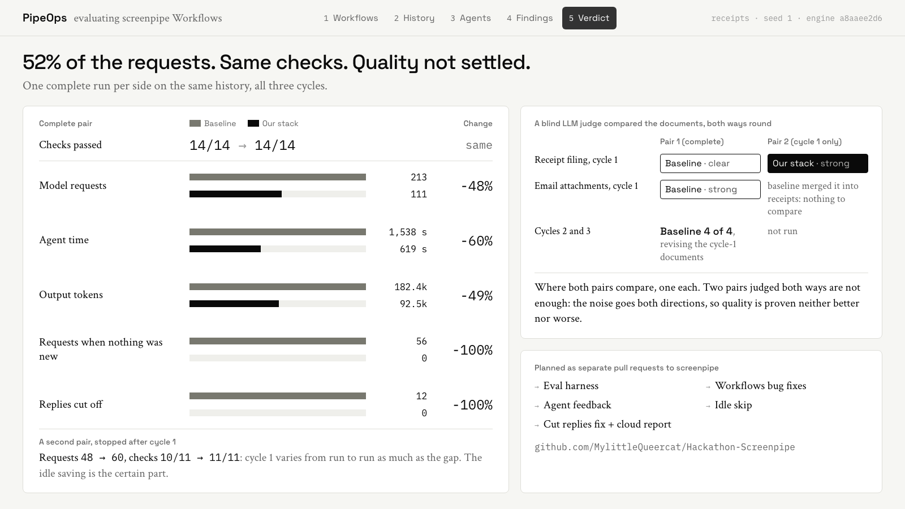

# PipeOps: prove it before you ship it

**Team PipeOps** · Build Agents That Remember · Track 01, *Find what to automate*

screenpipe Workflows reads your screen history and writes down the repeated work it finds,
so you can decide what to automate. When someone changes its agents, nothing tells them
whether discovery got better, worse, or just more expensive.

**PipeOps is the instrument for that.** It runs screenpipe's own Workflows agents on a
recorded week of work whose answers we know, grades what they publish, and measures what it
cost. We used it on Workflows itself: it found waste, validated fixes, and stopped us from
claiming more than the data shows.



## What we found

One complete run per side on the same history (receipts suite, seed 1, Claude Sonnet 5 on
both sides, engine `a8aaee2d6`). The agents run three cycles on synthetic history: cycle 1
after 4 recorded days, cycle 2 after a short session where a receipt naming rule changes,
cycle 3 with nothing new recorded.

| | Baseline | Our changes |
|---|---:|---:|
| Checks passed | 14/14 | **14/14** |
| Model requests | 213 | **111** (−48%) |
| Agent time | 1,538 s | **619 s** (−60%) |
| Output tokens | 182k | **92k** (−49%) |
| Requests when nothing was new | 56 | **0** |
| Replies cut off at their length limit | 12 | **0** |

- **The idle saving is certain:** with nothing new recorded, unchanged Workflows still ran 56
  requests; ours runs no cycle at all.
- **The rest is a direction, not a proof.** A second pair, stopped after cycle 1, went
  48 → 60 requests (checks 10/11 → 11/11): cycle 1 varies from run to run as much as the
  gap.
- **Quality is not settled.** A blind LLM judge compared every published document, both
  orders. Like for like, on the cycle-1 receipts document, it preferred baseline's in the
  complete pair and ours in the second pair. In the complete pair it also preferred
  baseline's email document and all 4 later documents, which revise the cycle-1 ones; in
  the second pair baseline merged email into receipts, so there was nothing to compare.
  Two pairs, judged both ways, are not enough: the noise goes both directions, so this
  proves quality neither better nor worse. The checks alone would not have shown any of
  it, which is why the judge is part of the eval.

The full log, with every run and every change tried, is in
[`eval/EXPERIMENTS.md`](eval/EXPERIMENTS.md).

## Try it: no account, no model calls

Node 18 or newer, any OS.

```sh
git clone https://github.com/MylittleQueercat/Hackathon-Screenpipe.git
cd Hackathon-Screenpipe/pipeops
npm install
npm run dev        # http://localhost:5173
```

Five screens on a fixed 16:9 canvas that scales to the window (`←` `→` or `1`–`5`):

1. **Workflows.** What screenpipe Workflows does: four agents turn recorded history into
   workflows that cite their sources. The question PipeOps answers.
2. **History.** The week of captures. *Show the planted jobs* reveals what Workflows should
   find: receipt filing with four exceptions, email attachments, a one-off printer setup
   that must not become a workflow, and noise.
3. **Agents.** Discover, Maintain, Deepen and Review on both sides, replayed from their
   request logs: every model request, every write the Workflows API refused, every reply
   cut off. Switch to *Cycle 3 · nothing new* to see the idle cycle disappear.
4. **Findings.** The checks next to the documents the agents published. Click a step to open
   the capture it cites. *Break it* damages the baseline's workflows four ways; the real
   grader catches each one with exactly the check it should.
5. **Verdict.** The numbers above, the judge, and what ships.

Everything shown is read from `pipeops/src/data/story.json`, built from the real run
artifacts by `pipeops/scripts/build-story.py`.

## How screenpipe is used

Without screenpipe there is nothing to evaluate: the project measures screenpipe's memory
turning into workflows.

- **The real engine and agents.** The harness builds screenpipe at `a8aaee2d6` and runs the
  four shipped Workflows agents (Pi, Claude Sonnet 5 through screenpipe cloud) against it.
  They search the history and publish through screenpipe's own API. We measure them; we
  don't reimplement them.
- **Recorded history, seeded.** A deterministic generator writes a synthetic week (frames with
  accessibility text, UI events, apps, windows, timestamps) into the engine through one
  added route, `/eval/seed`, which answers 404 unless the engine runs with
  `SCREENPIPE_EVAL_SEED=1`. The agents read what they would read from a real recording. No
  real user data is in this repo.
- **Graded against the truth.** Every published workflow's citations must resolve to real
  captures; the right jobs and exceptions must be found, the one-off and the noise not.
- **Isolated.** Runs use their own data dir and port, tools run in a container with no
  network, and your own screenpipe history is never read.

## Changes to screenpipe

The engine with our changes is in [`screenpipe/`](screenpipe/), one commit per change, in
the order they were measured. We plan to offer them to screenpipe as separate pull
requests so each can be taken alone:

| Pull request | What it changes |
|---|---|
| Eval harness | `wfeval` (in `eval/`) and the `/eval/seed` route |
| Workflows bug fixes | Agents cite whole seconds, captures carry milliseconds: such citations were refused. Descriptions were cut at 400 characters, open questions at 180 |
| Agent feedback | A refused write names the failing item, the revision to use and what the recorder holds at that time; Review handoffs are checked as publication would; quotes match window titles; drafts publish independently |
| Idle skip | No Discover cycle when nothing new was recorded (56 → 0 requests when idle) |
| Cut replies fix + cloud report | Pi's adapter sends `max_completion_tokens`, which screenpipe cloud ignores, so replies stop at 4,096 tokens; send `max_tokens` (12 → 0 cut replies) |

Only the two numbers in the table are attributed to a single change. The other savings
are measured for the whole stack; per-change runs are in `eval/EXPERIMENTS.md`, several
within run-to-run spread.

They were built and measured in sequence on `a8aaee2d6`; each will be rebased and re-tested
on current screenpipe before it is proposed.

## What works, what doesn't

- **Works:** the harness end to end on an Apple Silicon Mac (seed, run all four agents,
  grade, compare); stage replays of one agent from a saved state; the negative controls;
  the PipeOps app offline on any machine.
- **Prototype limits:** one synthetic suite (receipts) is fully measured, a second (`busy`)
  is built but not run live; the history is clean (no OCR noise, no audio, no meetings);
  two pairs of runs is too few to settle quality; the judge is one model family, the same
  one that wrote both sides.
- **Not reproduced outside the team yet.**

## Run a real evaluation (spends AI allowance)

An Apple Silicon Mac with the screenpipe desktop app (quit while running), a screenpipe
account with Workflows, Rust, `uv` and Docker. A full three-cycle run is about 200 model
requests (about 8 points of our weekly AI allowance) and 10 to 26 minutes of agent
time. Setup and commands: [`eval/README.md`](eval/README.md).

## Repo

| Part | What it is |
|---|---|
| [`pipeops/`](pipeops/) | The five-screen app (React, TypeScript, Tailwind, screenpipe's design system) |
| [`eval/`](eval/README.md) | `wfeval`: generator, seeding, runs, grader, stage replays, comparisons; `eval/judge/` the LLM judge |
| [`screenpipe/`](screenpipe/) | screenpipe at `a8aaee2d6` plus our changes |

## Team

<!-- TODO before submitting: one line per teammate, what they built. -->
