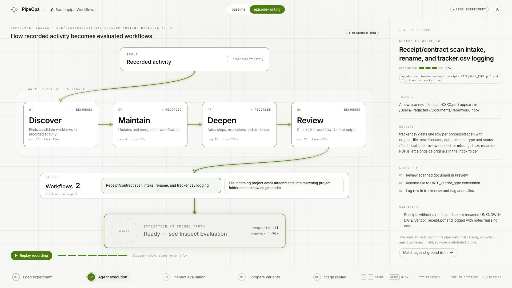
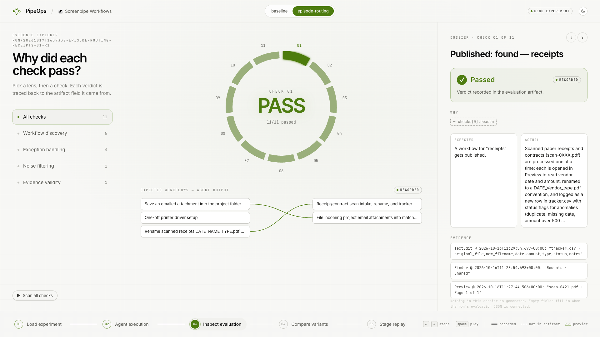
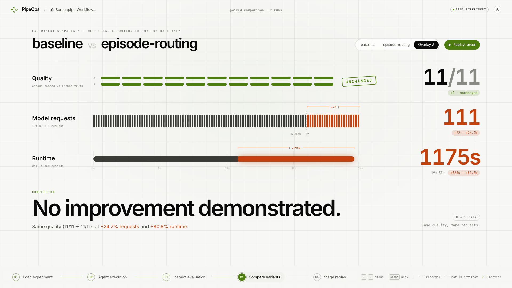
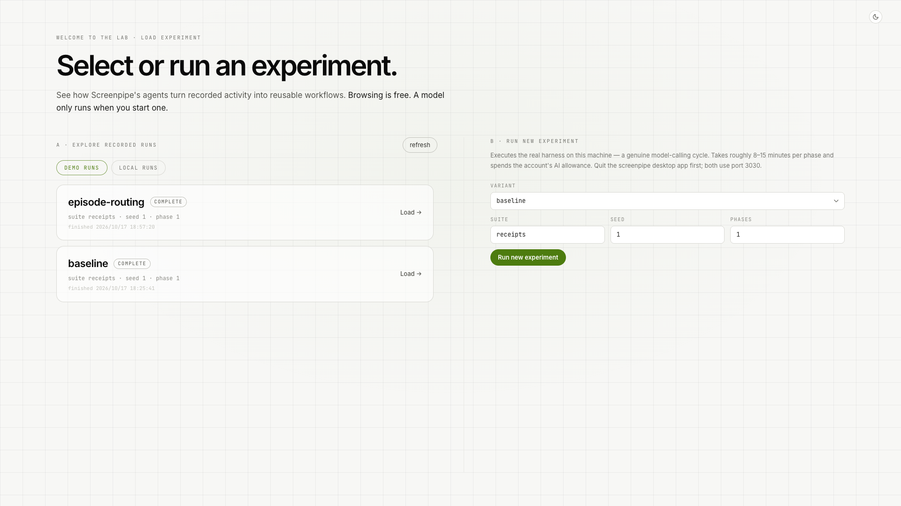
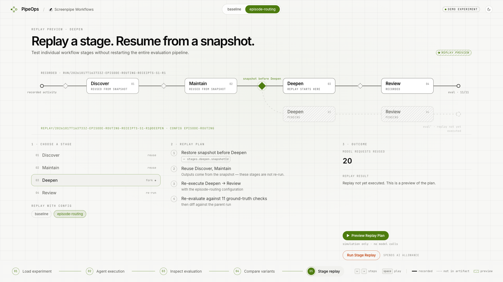

# PipeOps: Prove It Before You Ship It

> **Did your agent find the right workflows? And how much did it cost?**

**Team PipeOps** · Hackathon · Build Agents That Remember · Track 01, *Find what to automate*

screenpipe Workflows turns your screen history into potential automations. When a developer changes the
agents behind it, a prompt, a routing rule or the model, ordinary code tests cannot say whether it got better.
Two questions decide that:

- **Quality.** Did the agents discover the right work? Did they find the recurring task, keep its steps and
  exceptions, ignore irrelevant activity, and back every claim with evidence that really exists?
- **Efficiency.** What did it take to discover it? Model requests, token usage and runtime.

**PipeOps helps developers measure, compare and improve AI workflow agents, balancing discovery quality with
execution cost.** It runs the real Workflows agents against controlled activity histories with known answers,
scores the workflows they publish, and records what each run consumed.

Either number alone misleads. A cheaper agent that finds fewer workflows is not an improvement, and an agent
that finds the same workflows at a higher cost is not one either. Our own bundled pair shows it: baseline and
episode-routing both pass 11/11 checks, but the variant needs 111 model requests against 89 and 1175 s against
650 s, so PipeOps reports *no improvement demonstrated*.

With PipeOps a developer can:

1. **Evaluate** a run: what was discovered, what was missed, and the evidence behind each of the 11 checks.
2. **Compare** two agent versions under identical test conditions, on quality, model requests and runtime
   (the workbench), with token usage alongside in `wfeval compare` (the command line).
3. **Replay one stage** (say, only the Review agent) from a saved state instead of rerunning the whole cycle.
   A stage improvement is a lead, not proof: it does not by itself show the full pipeline got better.

> **Scope.** PipeOps evaluates how Workflows *discovers* workflows from activity (activity → agents →
> workflows). It does not measure what an automation saves a user once it is executed, and it reports
> tokens and runtime, not dollars, because we have no reliable price data to convert them.



## What's in this repo

| Part | What it is |
|---|---|
| [`eval/`](eval/README.md) | **`wfeval`**, the evaluation harness. Seeds a synthetic history into a real screenpipe engine, runs the shipped Workflows agents, and grades the workflows they publish against hidden ground truth. Also runs one agent alone from a saved state ("stage runs") and compares variants. Engine variants and what each measured are in `eval/variants/` and `eval/EXPERIMENTS.md`. |
| [`pipeops/`](pipeops/README.md) | **PipeOps**, the web workbench (React + TypeScript, small Express bridge, dark and light themes). Load an experiment, see what each agent did, inspect every check, compare two variants, replay a stage. Includes the export and validate scripts and its offline tests. |
| [`pipeops/demo-data/`](pipeops/demo-data/CONTRIBUTING.md) | Real, sanitized experiment results in a portable JSON format, so the demo runs on any laptop with no screenpipe account. Also holds `CONTRIBUTING.md`. |

## How screenpipe is used

Without screenpipe's memory there would be nothing to evaluate; the whole project is built
on top of it.

- **The real engine.** The harness builds screenpipe at a pinned commit (`a8aaee2d`) plus a
  small patch (`eval/patches/harness.patch`) that adds one route, `/eval/seed`, enabled only
  in eval mode. Nothing in the Workflows code is replaced.
- **Recorded history, seeded.** A deterministic generator writes a synthetic week of work
  (frames with accessibility text, UI events, app and window names, timestamps) into the engine
  in the same form screen capture would. The agents therefore read what they would read from a
  real recording, but there is no real user data in this repo.
- **The shipped agents.** Four Workflows agents (`workflow-discover`, `-maintain`, `-deepen`,
  `-review`) run against that history through screenpipe's own API (`/workflows/workspace`,
  `/activity-summary`, `/search`, `/frames`, `/meetings`). We measure them; we don't reimplement them.
- **The catalog it writes.** Each published workflow carries a trigger, an outcome, steps,
  variations, limitations, a confidence rating and cited evidence (`timestamp`, `app`). The
  harness checks that evidence resolves to real captured frames and that the right jobs were found,
  the one-offs were not, noise was ignored, and a changed naming rule updated the existing workflow.
- **Isolated by design.** Runs use their own data dir and port, tools run in a container with no
  network, and your real screenpipe history is never read.

## Quick start: run the demo (no accounts, no model calls)

Requires Node 18+ (tested on Node 20).

```sh
git clone https://github.com/MylittleQueercat/Hackathon-Screenpipe.git
cd Hackathon-Screenpipe/pipeops
npm install

npm run server     # terminal 1: data bridge on http://127.0.0.1:8787
npm run dev        # terminal 2: the UI on http://localhost:5173
```

Open <http://localhost:5173>. Nothing here calls a model: the app only reads recorded results.

### Reproduce the demo

1. **Enter the Lab.** At **Step 01** keep **Demo runs** selected and load `episode-routing`. It
   is paired automatically with `baseline`, which saw exactly the same data.
2. **Step 02, Agent execution.** Watch the pipeline Discover → Maintain → Deepen → Review with
   the real request count and agent time per stage. Click a stage for the agent's own summary, or a
   workflow chip to read its trigger, outcome, steps, variations, limitations and confidence.
3. **Step 03, Inspect evaluation.** Step through the 11 checks. Each one shows what was expected, what
   the agents produced and the evidence it traces to.
4. **Step 04, Compare variants.** Press **Run reveal**: same quality, higher cost, so the verdict is
   *no improvement demonstrated*. We report that as it is.
5. **Step 05, Stage replay.** Pick a stage and press **Preview Replay Plan** (a simulation, no model
   calls). Running it for real is a separate button that needs a saved snapshot, a built engine and an
   explicit confirmation, and it spends AI allowance.

Keyboard: `←` `→` or `1`–`5` move between steps, `space` plays the current step, and the corner
button switches dark and light.

| | |
|---|---|
|  |  |
|  |  |

## What we found

All runs: `receipts` suite, seed 1, Claude Sonnet 5. Full log in [`eval/EXPERIMENTS.md`](eval/EXPERIMENTS.md).

- **Full cycle, baseline vs episode-routing** (the bundled pair, above): no improvement. A change that
  does not help is a result too.
- **clearer-rejection** (the team's engine change, built on second-precision, that tells the Review
  agent *which* procedure items were rejected and why): on the Review stage, **18–19 requests and
  130–150 s against 38–56 requests and 390–470 s for baseline**, and 13–14k output tokens against 43–49k,
  with the same 11/11 on every run. The result is **the same quality, faster and cheaper**. These are
  stage runs (three repeats each) and are not comparable to full-cycle scores.
- **A grading error the harness helped expose.** Stage runs had been graded against ground truth that
  lacked a spelling the workflows legitimately use, which made one check look "missed". Regraded with the
  current truth, all 15 Review runs pass 11/11, so what separates the variants is cost, not quality. The
  correction is logged in [`eval/EXPERIMENTS.md`](eval/EXPERIMENTS.md).

## Run the tests (offline, no model calls)

```sh
cd pipeops && npm run typecheck && npm test            # exporter, validator, API safety, comparability
cd eval && uv run --group dev pytest -q                # generator, grader, negative controls, sandbox
```

If `uv run` fails with `No module named 'wfeval'` on macOS, run it as
`PYTHONPATH=src uv run …` (details in [`pipeops/README.md`](pipeops/README.md#troubleshooting)).

## Run a real evaluation (optional, spends AI allowance)

This needs an Apple Silicon Mac with the screenpipe desktop app (quit while running), a screenpipe
account with Workflows, Rust, `uv` and Docker. Setup and commands are in
[`eval/README.md`](eval/README.md). From PipeOps, Step 01 → *Run new experiment* starts a real run
behind a confirmation. A full cycle takes roughly 8–15 minutes per phase.

## Share your own experiment

Every `*.json` in [`pipeops/demo-data/`](pipeops/demo-data/) that passes validation appears under
**Demo runs** automatically.

```sh
cd pipeops
npm run export-run -- <runId>      # eval/runs/<runId> -> demo-data/<runId>.json
npm run validate-demo
```

Exports are allowlisted (metrics, checks, workflows, provenance hashes), exclude logs, prompts and
credentials, scan for secrets and host paths, and are refused if invalid. Two runs are only compared
when they share suite, seed, phases and data hashes, and stage results are never shown as full-evaluation
scores. See [`CONTRIBUTING.md`](pipeops/demo-data/CONTRIBUTING.md).
